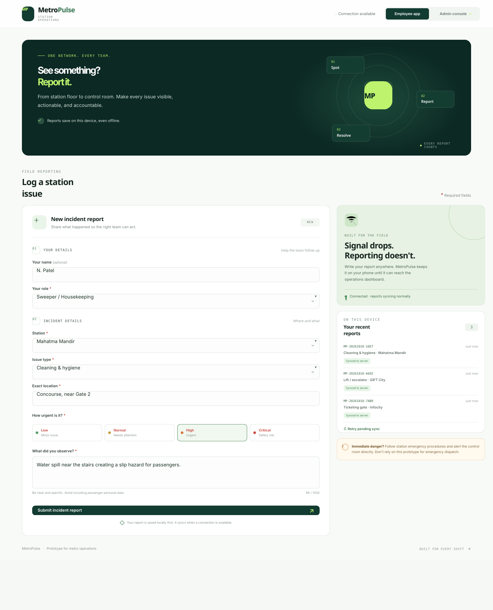
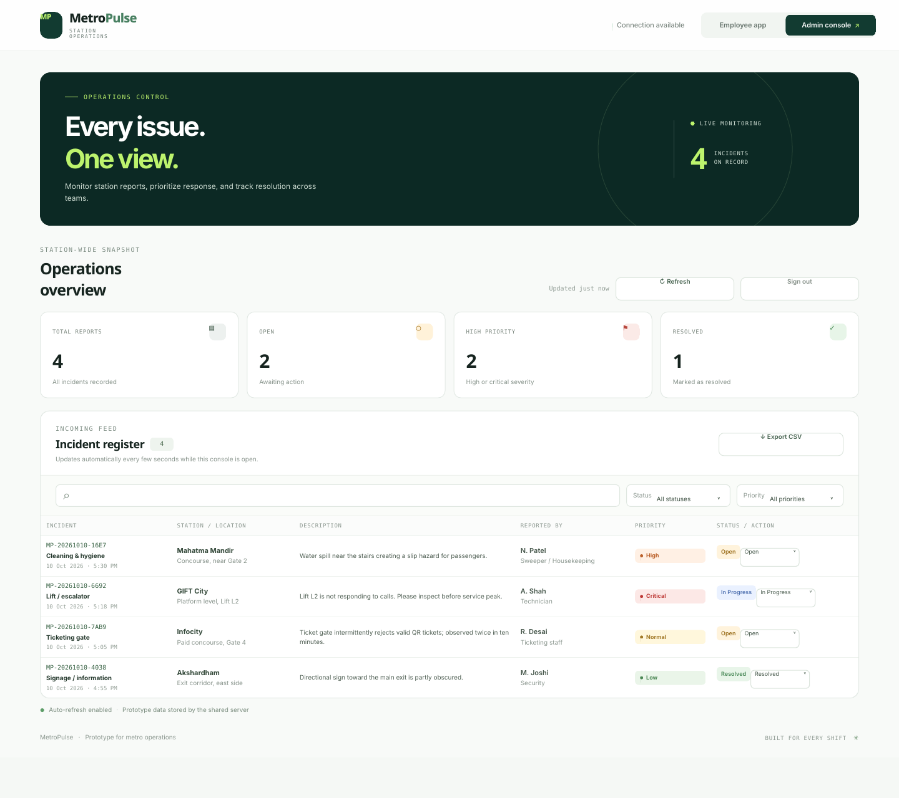
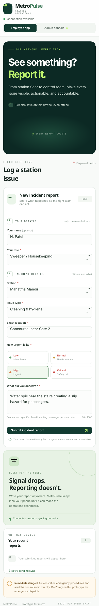
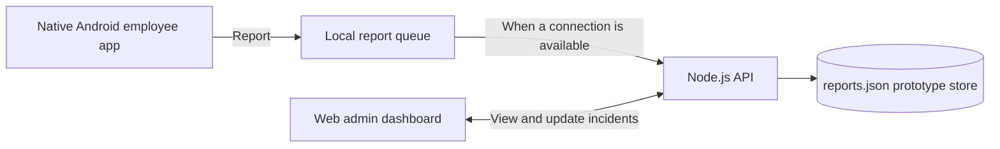

<div align="center">
  <h1>🚇 MetroPulse</h1>
  <p><strong>Offline-first incident reporting for metro operations</strong></p>
  <p>From the station floor to the operations dashboard — one trackable workflow for every report.</p>
</div>

MetroPulse is a hackathon prototype that connects frontline metro employees with operations staff through a **native Android reporting app**, a **Node.js API**, and a **web-based admin dashboard**. Employees can log a station issue even when connectivity drops; the report is stored on the device and retried when the connection returns. Once synced, the operations team can review its description, location and priority, then track it through **Open → In Progress → Resolved**.

> **Prototype status:** The end-to-end report-and-sync flow has been manually tested for the hackathon demo. This is not an official GMRC system, and it is not an emergency dispatch channel.

## At a glance

- **For frontline staff:** Submit an incident with staff role, station, exact location, issue category, severity and a description.
- **Offline-first reporting:** Save locally before sending; retry queued reports when connectivity returns.
- **Central incident register:** View incoming reports in one admin console, including their descriptions.
- **Triage and follow-through:** Search and filter by status/priority, update the status, and export reports as CSV.
- **Local server setup:** Configure the server URL inside the Android app under **Settings → Operations connection**.
- **Duplicate-safe sync:** Stable client IDs allow the backend to recognize a report that has already been received when local history is restored.

## Screenshots

The screenshots below are **static UI previews** rendered from the included web interface. Names and incident records shown are synthetic examples. The phone-sized image is the responsive web/PWA view, **not a screenshot of the native Android APK**; the native Android source project is included separately below.

<p align="center">
  
  
</p>

<details>
  <summary><strong>View the phone-sized responsive reporting preview</strong></summary>
  <p align="center">
    
  </p>
</details>

## How it works



The backend serves the web dashboard and API from the `metropulse/` folder. Reports are written to `metropulse/reports.json` for this prototype; that file is created at runtime and should **not** be committed to GitHub.

## Tech stack

| Component | Technology | Responsibility |
|---|---|---|
| Employee app | Native Android · Java | Incident form, local queue, sync and report history |
| Backend | Node.js built-in HTTP modules | REST endpoints, PIN-based demo admin session and report storage |
| Admin dashboard | HTML, CSS and JavaScript | Incident overview, filters, status changes and CSV export |
| Offline storage | Android `SharedPreferences` | Keeps locally queued reports on the device until they can be sent |
| Prototype persistence | JSON file | Stores reports on the server without requiring a database installation |

## Quick start: run the web dashboard and API

### Requirements

- Node.js 18 or newer
- Windows PowerShell, macOS Terminal or Linux shell

### 1. Configure the backend

From the repository root:

**Windows PowerShell**

```powershell
cd .\metropulse
Copy-Item .env.example .env
notepad .env
```

**macOS / Linux**

```bash
cd metropulse
cp .env.example .env
nano .env
```

Set your own `ADMIN_PIN` in `.env` and save the file. The value in `.env.example` is for local demonstration only; **change it before exposing the server through a public tunnel**.

### 2. Start the server

**Windows PowerShell**

```powershell
npm.cmd start
```

**macOS / Linux**

```bash
npm start
```

The dashboard and API run on port `3000` by default.

- **Admin dashboard:** `http://localhost:3000/?view=admin`
- **Employee web/PWA view:** `http://localhost:3000/?view=employee`
- **Health check:** `http://localhost:3000/api/health`

The health check returns the current server-side report count. Admin sign-in uses the `ADMIN_PIN` configured in `.env`.

## Build the native Android employee app

1. Install Android Studio and the Android SDK (compile SDK 35 is configured in this project).
2. Open `MetroPulseEmployeeAndroid/` in Android Studio and let Gradle sync finish. The project uses Gradle 8.9 and Android Gradle Plugin 8.7.3.
3. Select **Build → Generate APKs** (or **Build → Build Bundle(s) / APK(s) → Build APK(s)**, depending on your Android Studio version).
4. The debug APK is normally created at:

   `MetroPulseEmployeeAndroid/app/build/outputs/apk/debug/app-debug.apk`

5. Install that APK on an Android phone. In the app, open **Settings → Operations connection**, enter the backend base URL, and tap **Save address & test connection**.

### Connecting the phone to the server

Use the **base URL only**; the app checks `/api/health` itself.

- Same Wi-Fi / hotspot: `http://<laptop-LAN-IP>:3000` (allow Node.js through Windows Firewall on a trusted private network if prompted).
- Different networks: use a public HTTPS deployment or tunnel URL, such as `https://<your-tunnel-host>`. Keep the backend and tunnel running while demoing.

`localhost` on a physical phone means the phone itself, not your laptop. If the tunnel URL changes after a restart, update it in the app's Settings.

## Demo flow

1. Start the backend and open the admin console.
2. Configure and test the server URL in the Android app.
3. Submit a sample incident from the phone.
4. Verify that it appears in the admin incident register with its description and priority.
5. Disconnect the network and submit another sample report; reconnect and allow the queued report to sync.
6. Update the incident status in the web dashboard and, if useful for the demo, export the incident register as CSV.

Use **synthetic demo data** only. Do not enter passenger-sensitive or confidential operational information.

## API overview

| Endpoint | Method | Purpose |
|---|---|---|
| `/api/health` | `GET` | Check API availability and server-side report count |
| `/api/reports` | `POST` | Submit an incident; duplicate `clientId` values are recognized |
| `/api/admin/login` | `POST` | Create a demo admin session using the configured PIN |
| `/api/reports` | `GET` | Retrieve incidents for an authenticated admin session |
| `/api/reports/:id` | `PATCH` | Update an incident status to Open, In Progress or Resolved |

## Project structure

```text
MetroPulse/
├── README.md
├── .gitignore
├── docs/
│   └── screenshots/
│       ├── employee-reporting.png
│       ├── employee-mobile-web.png
│       └── admin-dashboard.png
├── metropulse/
│   ├── server.js
│   ├── package.json
│   ├── .env.example
│   └── public/                 # Web dashboard / employee web view / PWA assets
└── MetroPulseEmployeeAndroid/  # Native Android Studio project
```

## Limitations and next steps

MetroPulse demonstrates the reporting-to-dashboard workflow; it is not production metro infrastructure. The current prototype uses a JSON file rather than a managed database and uses a demo PIN rather than full employee identity and role-based access. Before any real operational deployment, add:

- Managed HTTPS hosting, staff authentication and role-based permissions
- Durable database storage, audit history, backups and retention policies
- Encrypted local data storage and monitoring for failed synchronization
- Approved operator procedures for critical incidents, escalation and closure
- Validated multilingual complaint triage and integrations with existing operator systems, if required

**Safety note:** Do not rely on MetroPulse for emergency dispatch. For immediate danger, staff must follow the metro operator's official emergency procedures and notify the control room directly.

---

<div align="center">
  <sub>Built for Metro Hacks · DevFest Gandhinagar · Hackathon prototype</sub>
</div>
